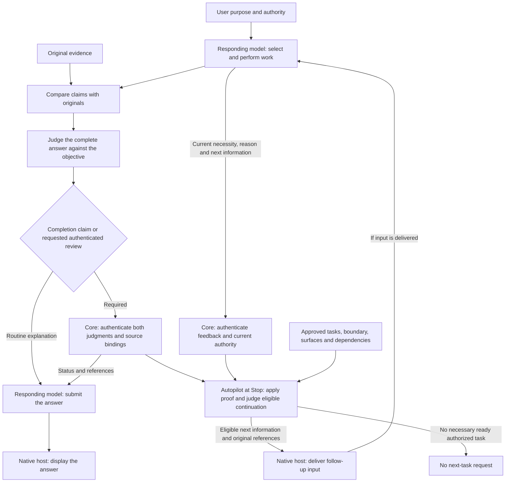

# ghost-alice-autopilot

Ghost-ALICE Autopilot continues needed work within actual user authority. The responding model judges the work and its results; Core authenticates original evidence and both response judgments; Autopilot records supported results and selects eligible tasks from an approved plan.

## How Autopilot extends Core

With Core alone, the responding model selects authorized work, performs it through native tools, judges each claim and then the complete answer, and records both judgments through Core when completion claims or a requested authenticated review require it. Routine explanations use the original comparisons without separate recording calls. Core authenticates the records; the native host displays the model's answer. The [Core architecture](https://github.com/AidALL/ghost-alice/blob/main/architecture.md) describes this standalone flow.

Installing Autopilot adds registered hooks for proof application and continuation within an approved plan. At Stop, the host independently invokes the Core guard and the Autopilot adapter. Autopilot consumes authenticated review and recording provenance to apply supported criteria. Separately, it consumes Core's current necessary-work feedback and checks the approved task, frozen boundary, surfaces, dependencies and prerequisite. It sends eligible next information and original references to the native host. The responding model performs that task when the host delivers the follow-up input. An unmet status alone creates no request.



The [design philosophy](https://github.com/AidALL/ghost-alice/wiki/design-philosophy-floor-not-ceiling) makes user purpose the standard for choosing necessary work. Judgment target, verification depth and full or partial completion evidence remain separate decisions.

Autopilot does not repeat the model's semantic review, create authority, perform business tools or intercept answer display. A task request proves neither host delivery nor execution. Unresolved required conditions stay visible while independent authorized work can continue. Recording defects preserve original proof and verification times without replaying unchanged work.

## Install and remove

Run the Core installer from the Core checkout:

```bash
bash install.sh --platform codex --addon autopilot
bash install.sh --platform claude --addon autopilot
```

Autopilot requires Ghost-ALICE Core 0.5.1 or later with its native hooks. For a development checkout, use the installer's `--addon-source` option with the addon repository. The Core installer registers the adapters and verifies their bindings. Autopilot has no standalone installer. See the [installation guide](https://github.com/AidALL/ghost-alice/blob/main/docs/getting-started/installation.md).

Remove the addon with the Core installer's `--uninstall --addon autopilot-mode` options and the intended platform. Full Core removal uses `--uninstall`.

## Completion and continuation

The model registers authorized tasks, dependencies, allowed surfaces and actual approval, and declares current necessity and next information through the existing Core route. Core records that feedback independently of Autopilot. Proof recording, criterion application, request emission, host delivery and task execution are separate results. An accurate partial answer can be accepted while required work remains incomplete. The [continuation procedure](./addons/autopilot-mode/skill/references/continuation.md#register-the-approved-plan) owns the calling details; the [operating skill](./addons/autopilot-mode/skill/SKILL.md#consistency-decisions) owns commands, targets and explicit queue callers.

Continuation carries the current reason, minimum next information and original references within the approved task. It does not replay the historical task prompt, source bodies, complete answer or ledger. A changed original holds only its dependent feedback row; unrelated approved work and proof remain intact. Empty or absent feedback, missing prerequisites and human stop do not erase proof or assert completion. Semantic suppression prevents unchanged retransmission; corrected current information can replace an unknown request while preserving its history. Necessary long originals remain available for lookup. Native conversation retention is a separate host responsibility.

Queued emissions, host receipts and action attempts are retained as immutable records. Current delivery and execution status are reconstructed from those records; editing displayed request state cannot grant a new execution identity or authenticate receipt. Superseded emissions remain observable when their native receipts arrive later. Reopening a stopped or blocked state in the admitted definition requires a newly approved plan.

## State and pause controls

Stored authority and public storage APIs govern work. Editing an export does not change authority. Source modification, checks, installation, native adoption and applied criteria are distinct observations. The [compatibility matrix](./compatibility-matrix.json) records tested targets; untested targets remain unverified.

| Pause marker | Affected run |
| --- | --- |
| `<project>/.autopilot/OFF` | Default runs for that business context |
| `<ghost-root>/autopilot/OFF` | Managed runtime runs |
| `<selected-run-dir>/OFF` | Selected run |

Autopilot honors applicable pause markers throughout preparation and Stop. Resume requires user authority; other remaining markers still apply. The operating skill defines target inspection and pause handling.

## License

Apache-2.0. See [LICENSE](./LICENSE) and [NOTICE](./NOTICE).
