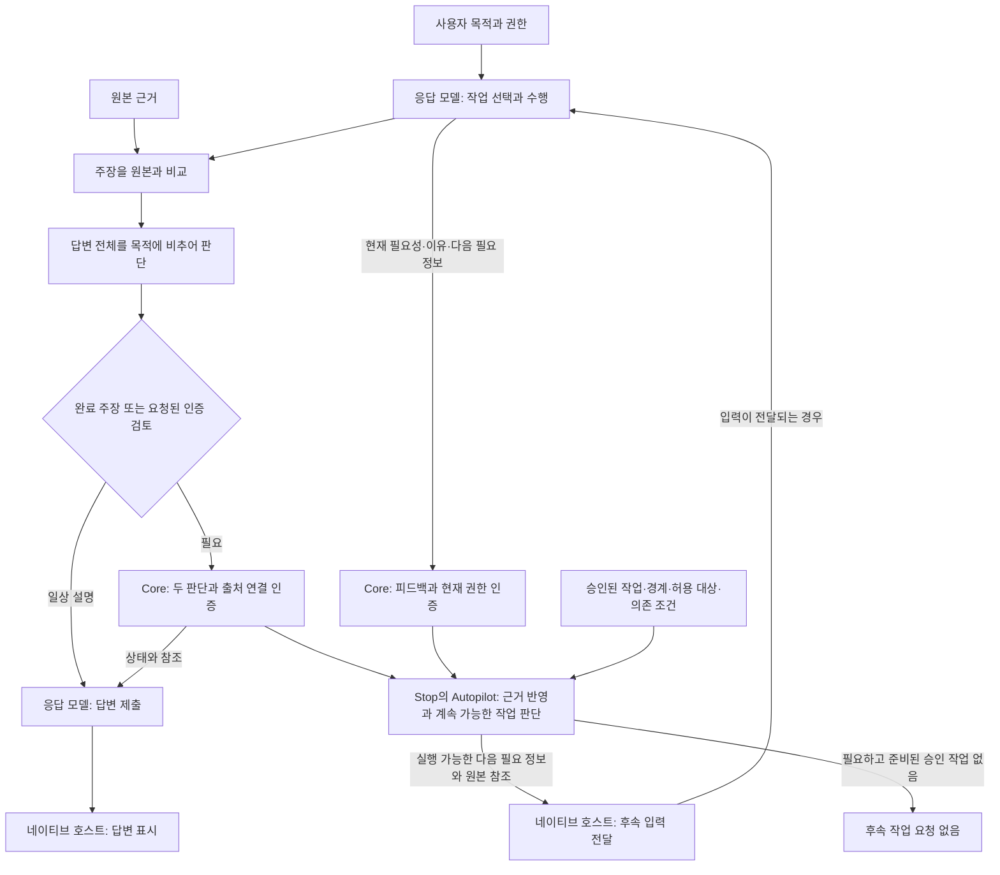

# ghost-alice-autopilot

Ghost-ALICE Autopilot은 실제 사용자 권한 안에서 필요한 작업을 이어갑니다. 응답 모델이 작업과 결과를 판단하고, Core가 원본 근거와 두 답변 판단을 인증하며, Autopilot이 지원된 결과를 기록하고 승인된 계획에서 실행 가능한 작업을 선택합니다.

## Autopilot 설치로 확장되는 Core 흐름

Core만 사용하는 경우, 응답 모델이 승인된 작업을 선택하고 네이티브 도구로 수행하며 각 주장과 답변 전체를 순서대로 판단한 뒤 완료 주장이나 요청된 인증 검토에 필요할 때 두 판단을 Core에 기록합니다. 일상 설명은 별도 기록 호출 없이 원본 대조와 전체 답변 판단을 수행합니다. Core는 기록을 인증하고 네이티브 호스트가 모델의 답변을 표시합니다. [Core 아키텍처](https://github.com/AidALL/ghost-alice/blob/main/architecture_ko.md)는 이 단독 흐름을 설명합니다.

Autopilot을 설치하면 근거 반영과 승인 계획 안의 계속 작업을 위한 훅이 등록됩니다. Stop에서 호스트는 Core 가드와 Autopilot 어댑터를 독립적으로 호출합니다. Autopilot은 인증된 검토와 기록 출처로 지원된 기준을 반영합니다. 이와 별개로 Core가 전달한 현재 필요한 미처리 정보를 사용해 승인된 작업·고정된 경계·허용 대상·의존 조건·전제 조건을 확인합니다. 실행 가능한 다음 필요 정보와 원본 참조를 네이티브 호스트에 보냅니다. 호스트가 후속 입력을 전달하면 응답 모델이 해당 작업을 수행합니다. 미충족 상태만으로 요청을 만들지는 않습니다.



[설계 철학](https://github.com/AidALL/ghost-alice/wiki/design-philosophy-floor-not-ceiling)은 필요한 작업을 선택할 때 사용자 목적을 기준으로 삼습니다. 판단 대상·검증 깊이·전체 또는 부분 완료의 근거는 별개의 결정입니다.

Autopilot은 모델의 의미 판단을 반복하거나 권한을 만들거나 실제 업무 도구를 실행하거나 답변 표시를 가로채지 않습니다. 작업 요청은 호스트 전달이나 실행을 입증하지 않습니다. 필수 미해결 조건은 드러내며 독립적으로 승인된 작업은 계속할 수 있습니다. 기록 결함이 있어도 원본 근거·검증 시각을 보존하고 변하지 않은 업무는 재실행하지 않습니다.

## 설치와 제거

Core 체크아웃에서 Core 설치기를 실행해 주세요.

```bash
bash install.sh --platform codex --addon autopilot
bash install.sh --platform claude --addon autopilot
```

Autopilot에는 네이티브 훅이 구성된 Ghost-ALICE Core 0.5.1 이상이 필요합니다. 개발 체크아웃에는 설치기의 `--addon-source` 옵션으로 애드온 저장소를 지정합니다. Core 설치기는 어댑터를 등록하고 연결을 검증합니다. Autopilot의 별도 설치기는 없습니다. [설치 안내](https://github.com/AidALL/ghost-alice/blob/main/docs/ko/getting-started/installation.md)를 참조해 주세요.

애드온 제거는 Core 설치기에 `--uninstall --addon autopilot-mode` 옵션과 대상 플랫폼을 지정합니다. Core 전체 제거에는 `--uninstall`을 사용합니다.

## 완료와 계속 작업

모델은 승인된 작업·의존 관계·허용 대상·실제 승인을 등록하고, 기존 Core 경로에 현재 필요성과 다음 필요 정보를 선언합니다. Core는 Autopilot 없이도 이 피드백을 기록합니다. 근거 기록·기준 반영·요청 발행·호스트 전달·작업 실행은 별개의 결과입니다. 정확한 부분 답변이 인정되어도 필수 작업은 미완료일 수 있습니다. [계속 작업 절차](./addons/autopilot-mode/skill/references/continuation.md#register-the-approved-plan)는 호출 상세를, [운영 스킬](./addons/autopilot-mode/skill/SKILL.md#consistency-decisions)은 명령·대상·명시적 queue 호출을 소유합니다.

계속 작업에는 승인된 작업 안에서 현재 이유·최소한의 다음 필요 정보·원본 참조를 전달합니다. 과거 작업 프롬프트·원문·답변 전문·원장을 다시 붙이지 않습니다. 원본이 바뀌면 그 원본에 의존하는 피드백 항목만 보류하며 독립적인 승인 작업과 근거는 유지합니다. 피드백이 없거나 빈 경우, 전제 조건이 없거나 사용자가 중지한 경우에도 근거를 지우거나 완료로 판단하지 않습니다. 의미가 같은 정보는 다시 보내지 않고, 정정된 현재 정보는 이전 요청의 수신 여부가 미확인이어도 그 이력을 보존하며 대체할 수 있습니다. 필요한 긴 원본은 조회할 수 있습니다. 네이티브 대화 이력 보존은 호스트의 별도 책임입니다.

요청 발행·호스트 수신·실행 시도는 불변 기록에 보존합니다. 현재 전달·실행 상태는 이 기록에서 구성하므로 표시된 요청 상태를 수정해도 새 실행 식별자나 수신 증거가 되지 않습니다. 교체된 요청도 이력에 남아 네이티브 수신 기록이 늦게 도착하면 확인할 수 있습니다. 승인 원본에 중지·차단 상태로 등록된 작업을 다시 열려면 새 승인 계획이 필요합니다.

## 상태와 일시정지

저장된 권한과 공개 저장 API가 작업을 관리합니다. 내보낸 파일을 수정해도 권한은 변경되지 않습니다. 소스 수정·검사·설치·네이티브 적용·기준 반영은 별개의 관찰입니다. [호환성 표](./compatibility-matrix.json)는 검사한 대상을 기록하며, 검사하지 않은 대상은 미확인으로 남습니다.

| 일시정지 표시 | 영향받는 실행 |
| --- | --- |
| `<project>/.autopilot/OFF` | 해당 업무 문맥의 기본 실행 |
| `<ghost-root>/autopilot/OFF` | 관리되는 런타임 실행 |
| `<selected-run-dir>/OFF` | 선택한 실행 |

Autopilot은 준비와 Stop 전반에서 적용되는 일시정지 표시를 따릅니다. 재개에는 사용자 권한이 필요하며 다른 표시가 남아 있으면 계속 적용됩니다. 운영 스킬은 대상 확인과 일시정지 처리를 정의합니다.

## 라이선스

Apache-2.0입니다. [LICENSE](./LICENSE)와 [NOTICE](./NOTICE)를 참조해 주세요.
